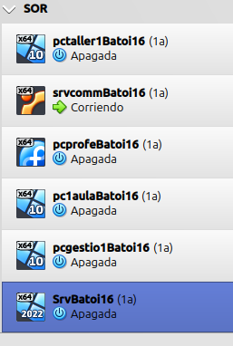
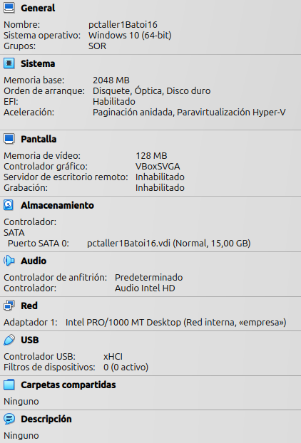

# AP-Q 2.1.1.
# Instalación y configuración del dominio

### Solo imagenes por petición del profesorado

Alumno: Yeray López Molina

Curso: 2º SMX

## VirtualBox

Imagen maquinas virtuales:

Detalles pctaller1Batoi16:

